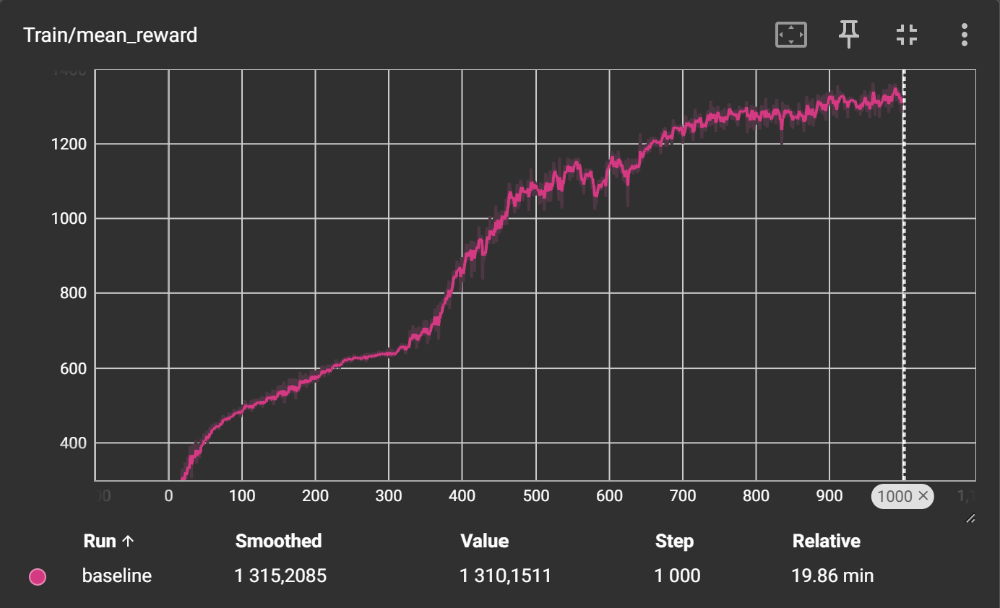
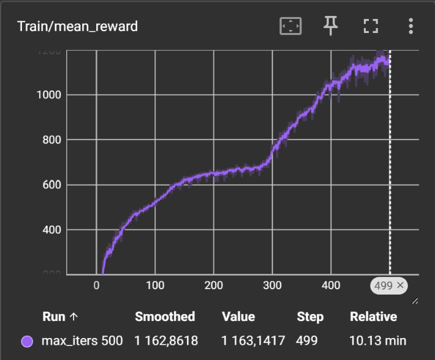
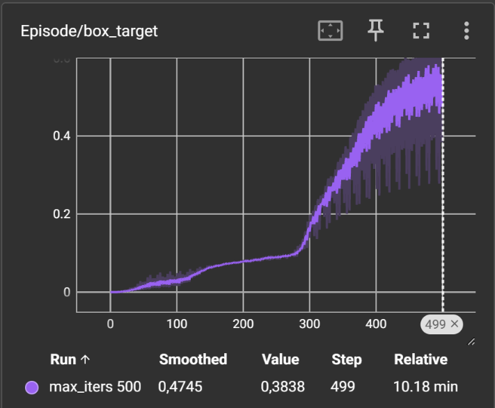
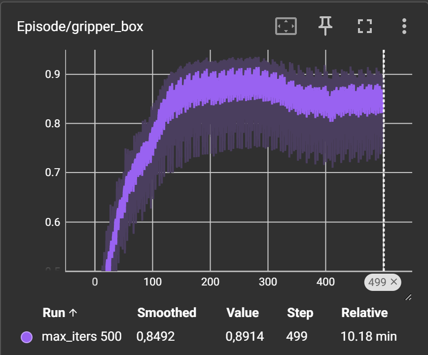
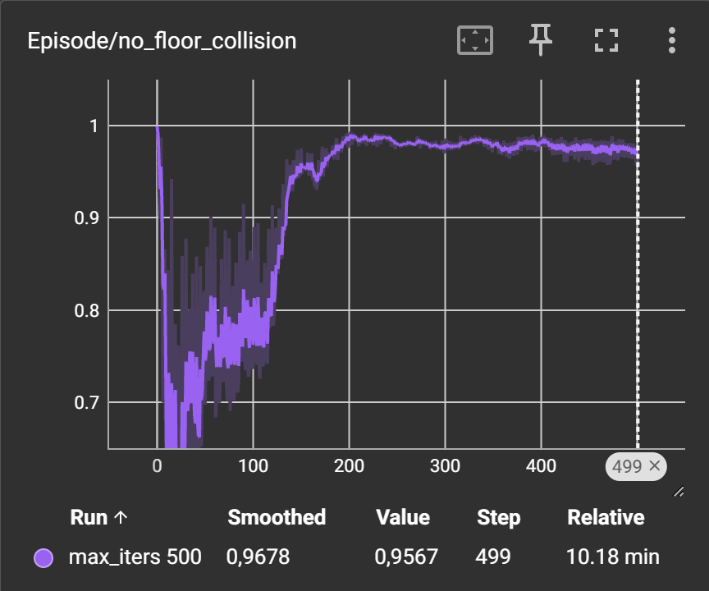

# Отчет Physical AI

| **Эксперимент**   | **Изменения в коде**                                  | **Команда запуска** | **Mean_reward** | **SR (k/10)** | **Δ mean_reward** | **Δ SR** | **Время, мин** | **Поведение**                                                                                                   |
|-------------------|-------------------------------------------------------|---------------------|-----------------|---------------|-------------------|----------|----------------|-----------------------------------------------------------------------------------------------------------------|
| Baseline          | \-                                                    | Colab               | 1279            | 8/10          | \-                | \-       | 19,6           | Рука дотягивается до кубика, берет его и успешно доносит до цели без какой-либо тряски.                         |
| MAX_ITERS = 500   | MAX_ITERS = 500                                       | Colab               | 1163            | 8/10          | 116               | 0        | 12.4           | Рука дотягивается до кубика, берет его и несет до цели, но появились потрясывания при поднесении кубика к цели. |
| box_target_strong | env_cfg.reward_config.scales.box_target = 40.0        | Colab               | 1020            | 0/10          | 259               | 8        | 20.0           | Рука сближается с кубиком, но ни разу не захватила его                                                          |
| qpos_strong       | env_cfg.reward_config.scales.robot_target_qpos = 30.0 | Colab               | 4528            | 0/10          | -3249             | 8        | 16.7           | Рука стоит на месте                                                                                             |

## 1. Первый тип модификации — изменение масштаба обучения

**Пример:** MAX_ITERS = 500.

**Что меняется:** количество итераций обучения уменьшено с 1000 до 500.

**На что влияет:** продолжительность обучения и количество опыта, которое успевает получить модель. Время обучения сократилось с 19,6 до 12,4 минуты.

**Поведение метрик:** mean_reward снизился с 1279 до 1163 (−116), при этом SR остался на уровне 8/10 (80%). Робот по-прежнему успешно переносит кубик к цели, но появились потрясывания при движении.

**Что не меняется:** функция награды, её компоненты и сама задача.

**Вывод:** сокращение числа итераций ускорило обучение без потери успешности выполнения задачи, но немного ухудшило качество движений робота.

## 2. Второй тип модификации — изменение веса основной компоненты награды

**Пример:** box_target = 40.0 (опыт box_target_strong).

**Что меняется:** увеличивается вес основной компоненты награды box_target, отвечающей за приближение кубика к цели.

**На что влияет:** приоритет оптимизации перемещения кубика к целевой позиции относительно других действий робота.

**Поведение метрик:** mean_reward снизился с 1279 до 1020 (−259), а SR упал с 8/10 до 0/10. Робот приближается к кубику, но не может его захватить.

**Что не меняется:** веса вспомогательных компонентов награды и общая структура задачи.

**Вывод:** усиление основной компоненты не улучшило выполнение задачи. Изменение баланса наград привело к тому, что робот перестал успешно захватывать и переносить кубик.

## 3. Третий тип модификации — усиление вспомогательной компоненты награды

**Пример:** robot_target_qpos = 30.0 (опыт qpos_strong).

**Что меняется:** значительно увеличивается вес вспомогательной компоненты robot_target_qpos, которая поощряет определённое положение суставов робота.

**На что влияет:** баланс между выполнением основной задачи и поддержанием заданного положения робота. При слишком большом весе вспомогательная награда может стать доминирующей.

**Поведение метрик:** mean_reward вырос с 1279 до 4528 (+3249), однако SR упал с 8/10 до 0/10. Робот стоит на месте и не пытается захватить кубик.

**Что не меняется:** веса основных компонентов награды и сама задача перемещения кубика.

**Вывод:** слишком сильное увеличение вспомогательной награды привело к тому, что робот начал получать высокий mean_reward, не выполняя основную задачу. Это показывает, что высокая суммарная награда не всегда означает успешное обучение.

**Общий вывод:** изменение масштаба обучения практически не повлияло на успешность модели. Усиление основной компоненты ухудшило обе метрики, а чрезмерное усиление вспомогательной компоненты повысило mean_reward, но полностью нарушило выполнение задачи. Поэтому при оценке обучения важно учитывать не только mean_reward, но и SR, а также фактическое поведение робота.

## Свой эксперимент

### Исследовательский вопрос

Как повлияет уменьшение параметра box_target с 8.0 до 4.0 на mean_reward, SR и поведение робота при захвате и переносе кубика?

### Формулировка гипотезы

**Параметр:** box_target, находится в env_cfg.reward_config.scales.

**Изменение:** уменьшим вес основной компоненты награды в два раза.

**Ожидание по mean_reward:** снизится относительно baseline (1279), поскольку награда за приближение кубика к цели станет меньше.

**Ожидание по SR:** снизится с 8/10 до 7/10 или ниже, поскольку у робота будет меньше стимула доводить кубик до целевой позиции.

**Обоснование:** в предыдущем эксперименте увеличение box_target до 40.0 привело к снижению SR до 0/10. Это показывает, что слишком большой вес основной компоненты нарушает баланс наград. Предполагаю, что чрезмерное уменьшение веса также может ухудшить результат, так как робот будет уделять меньше внимания доставке кубика к цели.

### Внесение изменения

Изменяем только один параметр:

```python
env_cfg.reward_config.scales.box_target = 4.0
```

Остальные параметры оставляем как в baseline, включая max_iters = 1000.

**Название эксперимента:** box_target_low

| **Эксперимент** | **Изменения в коде**                          | **Команда запуска** | **Mean_reward** | **SR (k/10)** | **Время, мин** | **Поведение** |
|-----------------|-----------------------------------------------|---------------------|-----------------|---------------|----------------|---------------|
| box_target_low  | env_cfg.reward_config.scales.box_target = 4.0 | Colab               | 649             | 0/10 | 18.9           |               |

### Подтвердилась ли гипотеза?

**Гипотеза подтвердилась по обеим метрикам.**

Предполагалось, что уменьшение веса box_target приведёт к снижению mean_reward и SR. В результате mean_reward снизился с 1279 до 649, а SR упал с 8/10 до 0/10.

Таким образом, модель не смогла успешно выполнить задачу ни в одном из 10 эпизодов. Ухудшение оказалось сильнее ожидаемого.

### Какие факторы могли повлиять на итоговые метрики?

Основным фактором стало уменьшение веса награды box_target в два раза. Из-за этого у робота снизился стимул перемещать кубик к цели относительно других компонентов награды.

Также на результаты могли повлиять случайность обучения и ограниченное количество тестовых эпизодов.

Снижение mean_reward частично связано с изменением самой функции награды, поэтому для оценки качества модели важнее учитывать SR.

### Практические выводы

Эксперимент показал, что уменьшение веса box_target до 4.0 привело к значительному ухудшению успешности модели.

В предыдущем эксперименте увеличение box_target до 40.0 также привело к SR = 0/10. Следовательно, как слишком большое, так и слишком маленькое значение этого параметра может нарушать баланс наград.

**Общий вывод:** для успешного обучения важно правильно подбирать веса компонентов функции награды. В наших экспериментах исходное значение box_target = 8.0 показало лучший результат — SR = 8/10. При этом для окончательного подтверждения закономерности желательно провести несколько повторных запусков.

## Кривая обучения

Просматривается быстрый рост в начале кривой, затем рост замедляется, и после примерно 700 шага кривая выходит на плато.



### MAX_ITERS = 500








